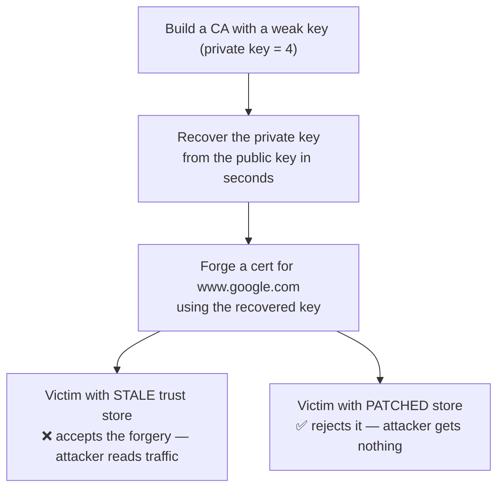

# eMudhra MITM PoC

Demo of the [Oct 2026 eMudhra/emSign CA incident](https://blog.mozilla.org/security/2026/10/20/protecting-firefox-users-following-the-compromise-of-emudhra-intermediate-certificates/): intermediate CA keys were so weak (one was literally `4`) that anyone could recover them from the public key and forge trusted certs. Patched browsers are fine — **anything with a frozen trust store isn't**.

This repo recreates the flaw with **our own throwaway keys** (never the real ones) and shows the impact.

## Run

```bash
pip install cryptography
./run_demo.sh
```

## How it works



**In one sentence:** we forge a CA certificate the way the real attacker could, then show one client accepting it (stale trust store) and one rejecting it (patched).

The chain being tested:

```
www.google.com (forged)  ←  weak intermediate (key = 4)  ←  root trusted before Oct 20
```

- STALE — store never updated → forgery validates → MITM works
- PATCHED — root removed (like OneCRL) → forgery rejected → safe

## What each script does

| Script | One-liner |
|---|---|
| `gen_weak_ca.py` | Builds a lab CA, weak-key intermediate, forged cert + the two trust bundles |
| `recover_key.py` | Brute-forces the weak private key from the public key alone |
| `mitm_demo.py` | Attacker HTTPS server + two curl victims (stale vs patched bundles) |

## Test your own machine

The scripts above demo with our throwaway keys. `check_client.sh` tests *your* real trust store against the operator's live test hosts:

```bash
./check_client.sh
```

The host serves a cert chaining to the compromised `EM DV TLS CA - G3B` (once via emSign, once via Sectigo's cross-sign, which Debian-family stores still trust). A patched client fails TLS verification. A stale client loads the page.

Measured on this repo's machine, macOS system curl (LibreSSL, `/etc/ssl/cert.pem`) accepted both chains — `SSL certificate verify ok`, issuer `EM DV TLS CA - G3B`. Run it and see.

Check any URL:

```bash
./check_url.sh https://example.com/   # NOT APPLICABLE - chain has no compromised key
./check_url.sh https://dv-g3b-emudhra.we-have-a-problem.com/   # VULNERABLE if you accept it
```

`check_url.sh` fetches the served chain, hashes every cert's SubjectPublicKeyInfo, and matches against the 8 compromised SPKI hashes (cached from the operator's `impacted-intermediates.json`). A verdict is `VULNERABLE` (chain matches and your client accepted), `SAFE` (chain matches, you rejected), `UNKNOWN` (nothing served), or `NOT APPLICABLE` (chain does not involve the keys). Exit codes: 1 vulnerable, 0 safe/not applicable, 2 unknown.

## Mapping to the real incident

| Here | Real world |
|---|---|
| Lab Root CA | emSign ECC Root CA - G3 |
| Weak intermediate (key=4) | 8 compromised emSign intermediates |
| `recover_key.py` | Researcher "Wayne" proving key possession, Oct 17 |
| Patched bundle | OneCRL / NSS 3.131.1 blocks, Oct 17–20 |
| Stale victim | Docker images, old JDKs, IoT firmware, kiosks |

## Rules

- Lab only — keys are local, trusted by nobody, DNS faked with `curl --resolve`.
- Never use the real eMudhra/emSign keys — illegal, CT-logged, monitored.

## If you maintain systems

- [ ] Rebuild Docker images / bump base images
- [ ] Update `certifi`, pip bundles, JDK `cacerts`, Node
- [ ] Grep pinned CA lists for `emSign` / `eMudhra`, remove them
- [ ] Audit mTLS client-CA stores on gateways
- [ ] Segment unpatchable devices (printers, cameras, kiosks)
