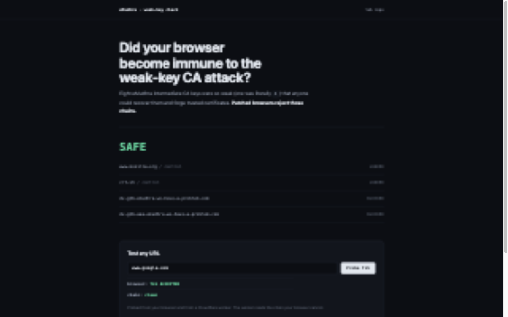
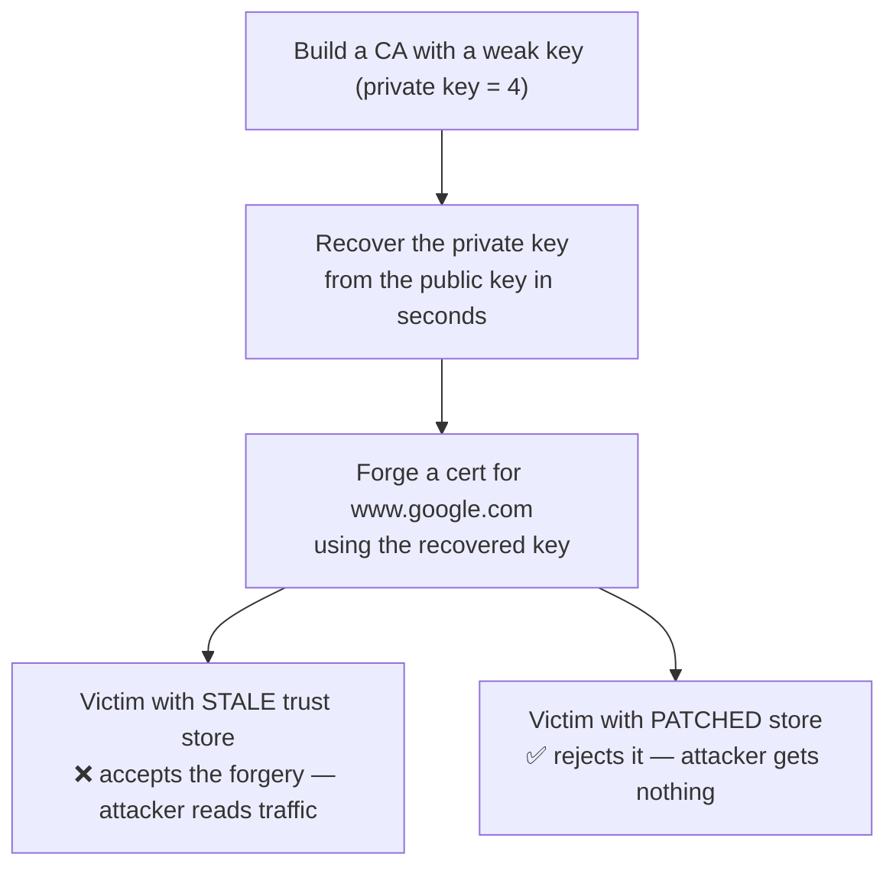

# eMudhra MITM PoC

Demo of the [Oct 2026 eMudhra/emSign CA incident](https://blog.mozilla.org/security/2026/10/20/protecting-firefox-users-following-the-compromise-of-emudhra-intermediate-certificates/): intermediate CA keys were so weak (one was literally `4`) that anyone could recover them from the public key and forge trusted certs. Patched browsers are fine — **anything with a frozen trust store isn't**.

This repo recreates the flaw with **our own throwaway keys** (never the real ones) and shows the impact.

## Run

```bash
pip install cryptography
./run_demo.sh
```

**Don't want to run anything?** The [live page](https://abhishek-bhatkar.github.io/emudhra-poc/) probes your browser against the incident's test hosts and tells you whether your browser still trusts the compromised chains. Type any hostname into **Test any URL** (bare hostnames like `www.google.com` and full URLs both work) and it reports two facts: `chain:` whether the served chain contains a compromised key, read by a Cloudflare worker, and `browser:` whether your browser accepted the TLS chain.



## How it works



**In one sentence:** we forge a CA certificate the way the real attacker could, then show one client accepting it (stale trust store) and one rejecting it (patched).

The chain being tested:

```
www.google.com (forged)  ←  weak intermediate (key = 4)  ←  root trusted before Oct 20
```

- STALE — store never updated → forgery validates → MITM works
- PATCHED — root removed (like OneCRL) → forgery rejected → safe

## What each script does

| File | One-liner |
|---|---|
| `gen_weak_ca.py` | Builds a lab CA, weak-key intermediate, forged cert + the two trust bundles |
| `recover_key.py` | Brute-forces the weak private key from the public key alone |
| `mitm_demo.py` | Attacker HTTPS server + two curl victims (stale vs patched bundles) |
| `check_client.sh` | Curl's the incident's live test hosts; your accept/reject is the verdict |
| `check_url.sh` | SPKI-hashes the served chain of any URL against the 8 compromised hashes |
| `worker/src/index.js` | Cloudflare worker returning served-chain SPKIs for the page's URL panel |

## Test your own machine

```bash
./check_client.sh                          # run against the incident's live test hosts
./check_url.sh https://example.com/        # NOT APPLICABLE / SAFE / VULNERABLE / UNKNOWN
```

- `check_client.sh` curl's the operator's live hosts, which serve certs chaining to the compromised `EM DV TLS CA - G3B` (via emSign and via Sectigo's cross-sign). A patched client fails TLS verification, a stale client loads the page. Measured here, macOS system curl accepted both.
- `check_url.sh <url>` hashes the served chain's SPKIs against the 8 compromised hashes (cached from the operator's public report). Verdict `VULNERABLE` = your chain contains a compromised key and you accept it. Exit 1 = vulnerable, 2 = unknown.

## The worker behind the page

`worker/` contains a Cloudflare Worker (`https://emudhra-chain-probe.bhatkar80.workers.dev/chain?host=example.com`) the page uses for the `chain:` fact. A static page cannot read certificate bytes, and a browser probe alone cannot distinguish "your build rejects the compromised CA" from "you lost connectivity", so the worker states the chain and the page computes the verdict.

- It talks TLS 1.2 itself over a `cloudflare:sockets` socket, stops right after the Certificate handshake message (plaintext before key exchange, no secrets involved), and reports the SPKI SHA-256 of every cert in the served chain.
- Results are cached at the edge for 60 seconds per host, so traffic spikes cost one handshake per host per minute.
- Verdicts remain three-state. Anything the worker cannot read is a fact named by the worker, and the page shows **UNKNOWN (no signal)** rather than any green.

Limits, measured this session:

- Some sites (including the incident's own test hosts) refuse TLS handshakes from cloud egress IP ranges. Those hosts read `no signal` from the worker; `check_url.sh` from your own machine still measures them.
- TLS 1.2-only hostnames are out of scope of the probe (they read `no signal` too).
- Deploy with `npx wrangler deploy` from `worker/` after `npx wrangler login`.

## Mapping to the real incident

| Here | Real world |
|---|---|
| Lab Root CA | emSign ECC Root CA - G3 |
| Weak intermediate (key=4) | 8 compromised emSign intermediates |
| `recover_key.py` | Researcher "Wayne" proving key possession, Oct 17 |
| Patched bundle | OneCRL / NSS 3.131.1 blocks, Oct 17–20 |
| Stale victim | Docker images, old JDKs, IoT firmware, kiosks |

## Rules

- Lab only — keys are local, trusted by nobody, DNS faked with `curl --resolve`.
- Never use the real eMudhra/emSign keys — illegal, CT-logged, monitored.

## If you maintain systems

- [ ] Rebuild Docker images / bump base images
- [ ] Update `certifi`, pip bundles, JDK `cacerts`, Node
- [ ] Grep pinned CA lists for `emSign` / `eMudhra`, remove them
- [ ] Audit mTLS client-CA stores on gateways
- [ ] Segment unpatchable devices (printers, cameras, kiosks)
