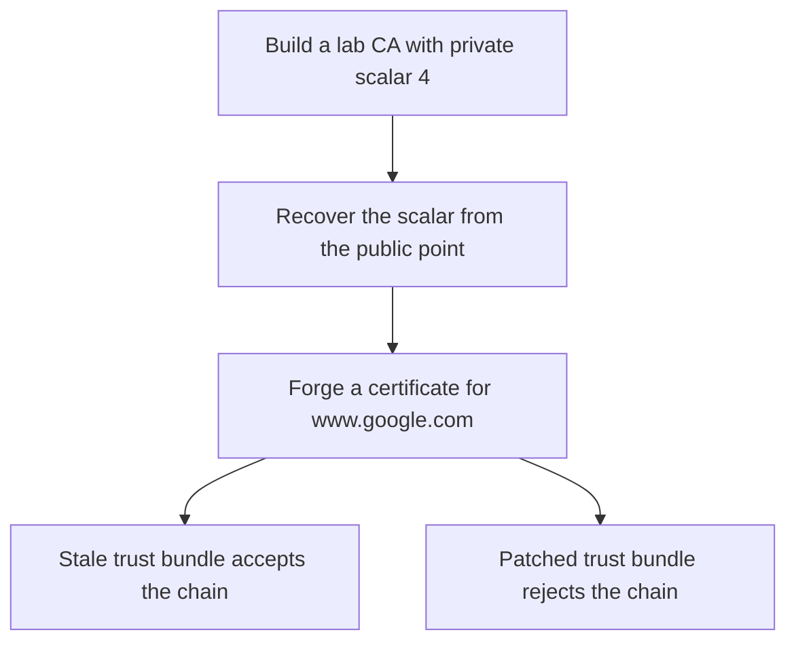

# eMudhra MITM PoC

Recreation of the [October 2026 eMudhra/emSign CA incident](https://blog.mozilla.org/security/2026/10/20/protecting-firefox-users-following-the-compromise-of-emudhra-intermediate-certificates/): eight intermediate CA keys were weak enough to recover and use for forged certificates. The lab uses only throwaway keys.

## Try it

**Live page** — [Cloudflare site](https://emudhra-poc.bhatkar80.workers.dev/) and [GitHub Pages mirror](https://abhishek-bhatkar.github.io/emudhra-poc/). The browser headline reports VULNERABLE only when a browser request completes and the Worker observes a listed SPKI for the same incident host. The observations use separate connections, so a proxy or changing server chain can affect their correlation. If the browser request completes without a matching chain, the page reports UNKNOWN. A failed or timed out request is also UNKNOWN because the browser cannot distinguish TLS rejection from a network failure. The custom URL form combines the served-chain identity with the browser request result.

**From your machine** —

```bash
./check_client.sh
./check_url.sh 'https://example.com?x=1'
pip install cryptography && ./run_demo.sh
```

The two check scripts need Python 3, OpenSSL, and curl 7.88 or newer with a TLS backend that supports the `%{certs}` write-out variable. They make one curl transfer per target. Backend support differs: some curl TLS backends omit certificate PEMs when a handshake is rejected. In that case the result is UNKNOWN because the rejected chain cannot be matched to the incident list from the same transfer. Both scripts read the checked-in SPKI list at `docs/data/incident.json`; they do not download or cache a replacement list.

The lab uses `cryptography` to create its throwaway certificates. The check scripts use Python's standard library and OpenSSL.

## How the checks classify a chain

The CLI reads the certificate chain and curl trust result from the same transfer.

| Result | Meaning |
|---|---|
| VULNERABLE | The chain contains a listed SPKI and curl accepted it. |
| SAFE | The chain contains a listed SPKI, curl rejected that same transfer with exit 60, and the TLS backend exposed the chain PEMs. |
| NOT APPLICABLE | Every certificate was parsed and the chain contains no listed SPKI. |
| UNKNOWN | The chain is missing, incomplete, malformed, or the trust result is inconclusive. |

`check_client.sh` applies this logic to both incident test hosts. A curl exit 60 alone never produces SAFE.

The browser uses `no-cors` requests. A resolved request proves that the browser completed a TLS connection to the host. A rejected request does not prove that TLS was rejected. DNS, a proxy, an extension, or a network failure can also reject the request. On the landing page, the browser result and Worker chain are observations from separate connections.

## How the lab works



| File | What it does |
|---|---|
| `poc/gen_weak_ca.py` | Creates the lab CA, intermediate, forged certificate, and trust bundles. |
| `poc/recover_key.py` | Recovers the weak intermediate scalar from its public point. |
| `poc/mitm_demo.py` | Runs the local HTTPS impostor and two curl victims. |
| `worker/src/index.js` | Reads the TLS 1.2 certificate chain and returns its SPKI hashes. |
| `tools/tlsfacts.py` | Parses HTTPS targets and classifies one curl transfer. |
| `docs/data/incident.json` | Shares the incident hosts and eight SPKI hashes with the page and CLI. |

The recovery code uses baby-step giant-step, which takes O(√n) point operations and memory. A 32-bit scalar needs about 2 × 2^16 point operations. The `--bits` demo accepts values from 1 through 32.

## The probe Worker

The browser cannot read certificate bytes, so the Cloudflare Worker speaks TLS 1.2 and stops after the plaintext Certificate message. It returns chain facts and does not make the client's trust decision. Workers Cache checks for a cached successful response before invoking the Worker and keeps it fresh for up to 60 seconds. `stale-if-error=0` prevents an expired success from being served when a probe fails. The response varies by `Origin`, so each allowed site origin receives matching CORS headers. Failures and preflight responses are not cached.

The Worker configures an IP-keyed Cloudflare Rate Limiting binding for 30 cache-miss probes per minute. Cloudflare describes these limits as approximate and per location. An [open Workers SDK report](https://github.com/cloudflare/workers-sdk/issues/16097) describes a live binding that did not enforce its threshold; this project has not verified live enforcement, so treat the binding as best-effort abuse control rather than a strict cap. Users behind the same NAT may share a bucket. Cache misses fail closed with HTTP 503 if the binding is unavailable. The Worker allows browser requests only from the configured site origins. CORS does not authenticate direct API callers.

The GitHub Actions workflow deploys both the site and the probe Worker with Wrangler 4.69.0 when site or Worker files change. GitHub Pages continues to deploy from `main`.

## Mapping to the real incident

| Here | Real world |
|---|---|
| Lab Root CA | emSign ECC Root CA - G3 |
| Weak intermediate with scalar 4 | Eight compromised emSign intermediates |
| `recover_key.py` | Researcher “Wayne” proving key possession, October 17 |
| Patched bundle | OneCRL and NSS 3.131.1 blocks, October 17–20 |
| Stale victim | Frozen trust stores in older software and devices |

## Rules

- Lab only. Keys are local, and the demo overrides DNS with `curl --resolve`.
- Never use real eMudhra or emSign keys. Forging them is illegal, logged in Certificate Transparency, and monitored.

## If you maintain systems

- [ ] Rebuild Docker images or update base images.
- [ ] Update `certifi`, JDK `cacerts`, and Node trust stores.
- [ ] Remove eMudhra or emSign roots from pinned CA lists.
- [ ] Audit mTLS client CA stores on gateways.
- [ ] Segment unpatchable devices such as printers, cameras, and kiosks.
