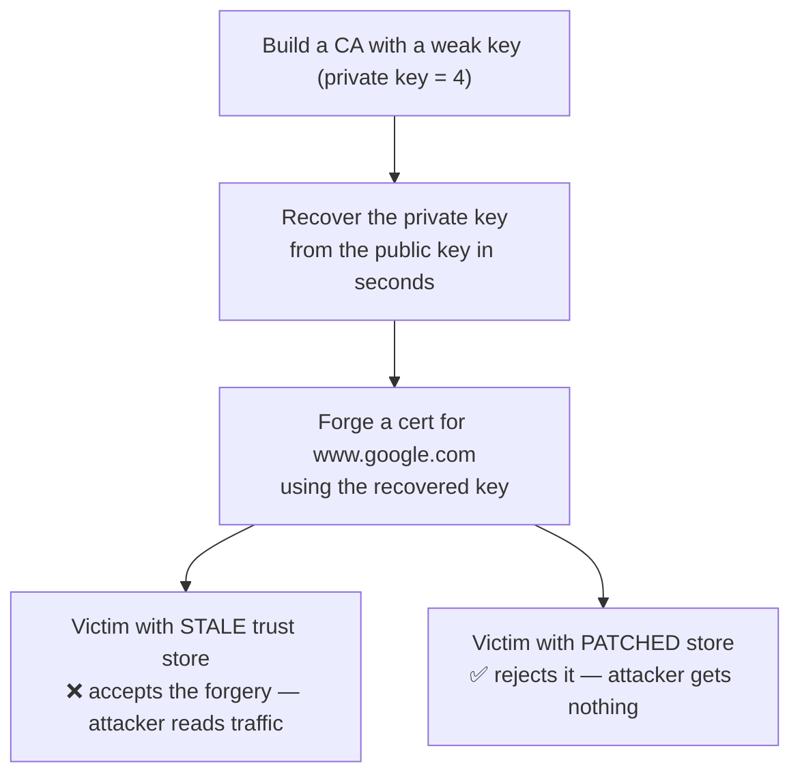

# eMudhra MITM PoC

Recreation of the [Oct 2026 eMudhra/emSign CA incident](https://blog.mozilla.org/security/2026/10/20/protecting-firefox-users-following-the-compromise-of-emudhra-intermediate-certificates/): 8 emSign intermediates had keys so weak (one was literally `4`) that anyone could recover them from the public key and forge trusted certs. Patched browsers are fine. Anything with a frozen trust store (Docker images, old JDKs, IoT firmware) is not.

This repo recreates the flaw with **our own throwaway keys** (never the real ones) and shows the impact.

## Try it

**Live page** — [abhishek-bhatkar.github.io/emudhra-poc](https://abhishek-bhatkar.github.io/emudhra-poc/). Probes your browser against the incident's test hosts and any URL you type (bare hostnames work). Three verdicts only: SAFE, VULNERABLE, UNKNOWN. A network failure never reads as SAFE.


**From your machine** —
```bash
pip install cryptography && ./run_demo.sh   # full lab demo
./check_client.sh                           # your curl vs the incident's live hosts
./check_url.sh https://example.com/         # SPKI-hashes any served chain vs the 8 compromised keys
```

## How it works



| File | What it does |
|---|---|
| `gen_weak_ca.py` | Lab CA, weak-key intermediate, forged cert, two trust bundles |
| `recover_key.py` | Brute-forces the weak private key from the public key alone |
| `mitm_demo.py` | Attacker HTTPS server + two curl victims (stale vs patched) |
| `worker/src/index.js` | Cloudflare worker returning served-chain SPKI hashes for the page |

## Mapping to the real incident

| Here | Real world |
|---|---|
| Lab Root CA | emSign ECC Root CA - G3 |
| Weak intermediate (key=4) | 8 compromised emSign intermediates |
| `recover_key.py` | Researcher "Wayne" proving key possession, Oct 17 |
| Patched bundle | OneCRL / NSS 3.131.1 blocks, Oct 17–20 |
| Stale victim | Docker images, old JDKs, IoT firmware, kiosks |

## The worker behind the page

The static page cannot read certificate bytes, so a Cloudflare Worker (`emudhra-chain-probe.bhatkar80.workers.dev`) speaks TLS 1.2 itself, stops right after the plaintext Certificate message (no secrets involved), and reports the SPKI SHA-256 of every cert in the served chain. Results are edge-cached 60s per host. Hosts that refuse cloud-egress handshakes (including the incident's test hosts) read `no signal`, and the page shows UNKNOWN rather than any green.

## Rules

- Lab only. Keys are local, trusted by nobody, DNS faked with `curl --resolve`.
- Never use the real eMudhra/emSign keys. Illegal, CT-logged, monitored.

## If you maintain systems

- [ ] Rebuild Docker images / bump base images
- [ ] Update `certifi`, pip bundles, JDK `cacerts`, Node
- [ ] Grep pinned CA lists for `emSign` / `eMudhra`, remove them
- [ ] Audit mTLS client-CA stores on gateways
- [ ] Segment unpatchable devices (printers, cameras, kiosks)
