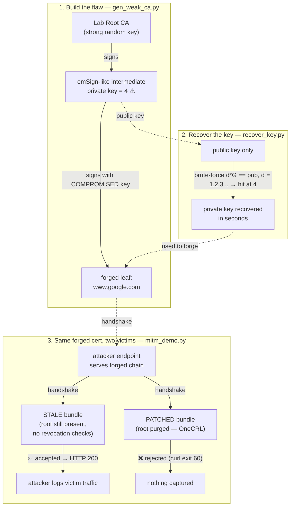

# eMudhra MITM PoC

Demo of the [Oct 2026 eMudhra/emSign CA incident](https://blog.mozilla.org/security/2026/10/20/protecting-firefox-users-following-the-compromise-of-emudhra-intermediate-certificates/): 8 intermediate CA keys were so weak (one was literally `4`) that anyone could recover them from the public key and forge trusted certs. Patched browsers are fine — **anything with a frozen trust store isn't**.

This repo recreates the failure mode with **our own throwaway keys** (never the real ones) and shows the impact.

## Run

```bash
pip install cryptography
./run_demo.sh
```

Needs Python 3.10+, curl, openssl.

## What you'll see

```
STEP 1  Build a lab CA whose intermediate private key is scalar 4
STEP 2  Recover that private key from the public key alone  (d = 4, ~0s)
STEP 3  MITM two victims with the same forged cert:

  STALE bundle   -> handshake OK, HTTP 200, attacker logs the traffic
  PATCHED bundle -> handshake rejected, nothing captured
```

`run_demo.sh` = `gen_weak_ca.py` (forge cert chain) + `recover_key.py` (brute-force the key) + `mitm_demo.py` (attacker server + two curl victims).

## How it works



The cert chain at play (what each client validates):

```
leaf "www.google.com"          ← attacker's forgery
 └─ signed by  emSign-like intermediate   ← the COMPROMISED key (scalar = 4)
     └─ signed by  emSign-like root        ← trusted on Oct 17, purged by Oct 20
```

STALE = trust store frozen before Oct 20 → chain validates → game over.
PATCHED = root removed (OneCRL / NSS 3.131.1 behavior) → chain fails → protected.

## Mapping to the real incident

| Here | Real world |
|---|---|
| Lab Root CA | emSign ECC Root CA - G3 |
| Weak intermediate (scalar=4) | 8 compromised emSign intermediates |
| `recover_key.py` | Researcher "Wayne" proving key possession to Mozilla/Chrome/Apple/MS, Oct 17 |
| `patched-ca-bundle.pem` | OneCRL / NSS 3.131.1 / vendor blocks, Oct 17–20 |
| Stale curl victim | Docker images, old JDKs, IoT firmware, kiosks — anything shipping its own roots |

## Rules

- Lab only — all keys are local, trusted by nobody, DNS is faked with `curl --resolve`.
- Never use the real eMudhra/emSign keys — illegal, CT-logged, and monitored.

## If you maintain systems

- [ ] Rebuild Docker images / bump base images (fresh `ca-certificates`)
- [ ] Update `certifi`, `pip`, curl bundles, JDK `cacerts`, Node
- [ ] Grep pinned CA lists for `emSign` / `eMudhra` and remove them explicitly
- [ ] Audit mTLS client-CA stores on gateways / load balancers
- [ ] Assume unpatchable devices are MITM-able on hostile networks — segment them
